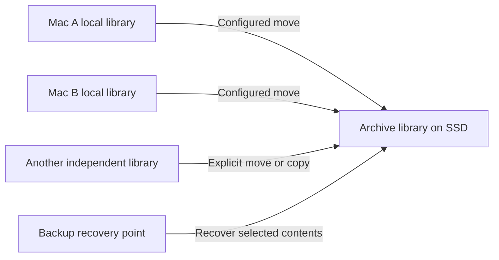

# Pharos onboarding and library plan

Status: product decisions agreed; the audit, clickable onboarding prototype,
staged technical design and production implementation are present in this branch.
See [operating guide](library-management.md) for the implemented flows.

Pharos should open named libraries independently of where the application is
installed. Libraries hold both captured history and the user's organization of
that history. They can exchange data through explicit moves, copies, and recovery
operations. This supports local use, carrying an SSD between Macs, independent
libraries on several machines, and safe backup recovery exercises.

The work proceeds through conceptual review, an audit of feasibility assumptions,
onboarding mocks, a broader repository audit, and a staged technical design.
The deliverables below capture that work for review. Production schemas,
transfer protocols, and APIs belong to the design's implementation stages.

## Review deliverables

- [Repository audit](onboarding-and-library-audit.md): scope findings, code
  evidence, storage constraints, and a data classification for safe migration.
- [Clickable HTML prototype](mocks/onboarding.html) and
  [walkthrough](mocks/README.md): setup, library selection, optional backups,
  pending-history moves, recovery, and the per-application per-Mac MCP setting.
- [Technical design and build stages](onboarding-and-library-design.md):
  identities, runtime isolation, the MCP connection gate, lossless transfers,
  verified cleanup, recovery boundaries, and acceptance tests for rollout.

The prototype uses simulated in-memory data. It does not capture, move, recover,
or delete any real library data or change actual MCP settings.

## Current scope

Support whole-library history transfers, ordinary source selection within each
library, and an explicitly configured move from a local library to its archive
destination. Both a traveling SSD and independent libraries that are later
combined remain supported.

Repository routing rules, filtered transfers, splitting a library by a query,
automatic transfer graphs, and a new conversation-deletion feature are outside
this work. They impose no requirements on the initial storage model. Library
migrations can provide a foundation for exploring splits later. Automatic
whole-library delivery remains part of this plan; removing routing rules does
not remove delivery when an archive reconnects.

## Agreed product behavior

### Application location and library location are independent

Installing Pharos in Applications and running it from an SSD are both supported
approaches. Applications will probably be the more common location, but portable
use remains a first-class path in onboarding and documentation.

| Application location | Library location | Experience |
| --- | --- | --- |
| Applications on this Mac | Internal storage | Local installation and local library |
| Applications on this Mac | External SSD | App remains available while that library is disconnected |
| External SSD | The same SSD | Carry the application and library between Macs without installing Pharos on each Mac |
| Either | Several libraries | Choose a library, open more than one, and configure transfers between them |

New installations use sensible storage defaults. Installing the app in
Applications does not put catalogs, captures, backups, or other working files
beside it. Each library keeps its durable contents together in a named folder by
default. Independently placing each library component is an advanced concern.

### Portable use stops when the SSD is absent

When the application lives only on the SSD, Pharos does not install a helper,
background service, or local capture library. Removing the SSD makes Pharos
unavailable until it is reconnected. There is no capture while the application
is absent, and no retained local conversation history or offline search cache.

Portable mode keeps its Pharos-managed files on the SSD. Machine-specific source
bindings can be stored there under the relevant machine's identity. Remembering a
binding does not grant OS permissions or authorize capture on a new Mac.

Small non-history settings may remain on the Mac: update consent and update
coordination, window state, and explicitly requested agent registration. These
exceptions must be documented. No helper, conversation history, or history-derived
cache remains locally. Cover caches can contain history-derived information and
are not harmless operational residue. OS-managed permission records must be
described separately from files and services Pharos controls.

### User choices travel with their library

Bookmarks, saved queries, dashboard changes, annotations, organization, and
preferences belong to the library. Opening that library on another Mac brings
those choices along. Backups include this durable user-created state.

Source definitions stay in the library's host-scoped files in both local and
portable installations. Moving the library then preserves its bindings for
every known Mac. A binding being machine-specific does not require storing it
outside the library. OS permissions and secret credentials remain separately
authorized; carrying a source definition does not grant access on another Mac.

For local installations, library discovery, launch and integration selection,
window placement, and runtime resources may live on the Mac. Saved queries and
default views are durable user choices; last-used queries, panel state, query
rejection state, and regenerated previews are local session or cache state.
Portable mode must separately meet its footprint requirements.

Opening the same library on two Macs and merging two independent libraries are
different operations. The former carries all library preferences. The latter
must not overwrite destination preferences or discard source user-created state.
Initial history transfers leave both libraries' user-created state intact and
do not combine preferences, bookmarks, or dashboards. Full-library restoration
still carries saved user state. A source bookmark whose history moves needs a
visible destination or unavailable state; cleanup must not discard the bookmark.

### Multiple libraries are an ordinary use case

A library has its own name, identity, history, and preferences. "Local inbox,"
"SSD archive," and "restored test copy" describe uses of libraries rather than
separate storage formats. The app supports choosing among available libraries
and opening more than one. The active library is always apparent.

Choosing the library to browse does not change capture destinations. Opening a
restored test copy must not redirect capture or activate imported schedules.

Connecting a disk or opening a library does not automatically authorize data
exchange. A local library can have an explicitly selected archive destination
for whole-library moves. Arbitrary routing rules are deferred.

Each application installation on each Mac has an MCP library setting. It defaults
to that application's first library and changes only through an explicit action
in MCP settings. Opening another library never changes this assignment.

MCP answers only while that application is connected to its assigned MCP library.
If the application is connected to a different library, MCP appears unavailable
or returns a helpful error explaining that Pharos is working with another library
and naming the assigned library. It never silently queries the other library or
opens the assigned catalog behind the application's back. Several open windows
do not implicitly choose the MCP connection; the design must define one explicit
application connection state for this check.

The setting is local to the application installation and Mac, not a portable
library preference or a global default shared by every installed copy. The same
SSD application can have a different assignment on another Mac. Ask Pharos uses
the library in which its chat was started, including follow-up requests, and
makes that scope visible. It already uses a private lookup interface and does
not require the external agent's MCP registration.

### Local capture uses an ordinary library

An installation running from the Mac can capture into a local library while an
external destination is unavailable. The user can browse that local library's
pending history. When the destination returns, a configured move delivers that
history into it.

This works for any source and destination libraries, regardless of disk type.
The model supports both a single SSD traveling between Macs and independent
libraries whose history is later combined. Full offline copies of an archive
are not required for local capture to work.

### Automatic delivery empties transferred history from the source

Automatic delivery is a move. Once the destination durably holds and verifies the
transferred information, Pharos removes the corresponding history and retained
files from the source library. It does not keep a recent-history window or an
offline cache of the delivered conversations.

The emptied library retains its identity, settings, capture progress, and small
transfer receipts. This bookkeeping prevents unchanged captured data still
present in an agent's source files from being captured back into the local
library after every move. Later changes to a delivered conversation can become
new pending history and move through the same route.

Cleanup concerns Pharos's own stored copies. It does not remove the original
conversation files owned by Claude, Codex, Conductor, or another source.

### Verified moves do not depend on backups

Backups are optional and are expected to be a power-user feature. Their presence,
configuration, or freshness does not block ordinary operation, moves, or cleanup
after a verified move. Once a write from library A is durable and verified in
library B, its corresponding source data can be deleted from A.

A move can therefore leave one surviving library copy. Backup setup may explain
and improve protection, but it is not a prerequisite disguised as an onboarding
step. Cloud backup can become another destination when implemented.

### Move and merge preserve information

Conversation identity follows the original provider or source, account, and
native record identity, independently of the library currently holding it.
Machine and source provenance survive moves; an original path is not silently
reinterpreted as a source on another Mac. Identical text alone is not enough to
identify two conversations as the same conversation.

| Incoming history | Required outcome |
| --- | --- |
| A revision already represented in the destination | Avoid duplication; verify coverage before source cleanup |
| A revision extending known history | Incorporate the extension |
| An older or incomplete copy | Preserve newer or more complete destination information |
| Divergent copies of the same conversation | Preserve distinct information before cleanup; do not pick a winner solely by clock time |
| Unrelated conversations with identical prompts | Keep their identities separate |

A complete transfer includes the retained evidence and referenced files needed
to preserve the information being moved. Moving only searchable rows is
insufficient. Rebuildable indexes and derived metrics must not create duplicate
conversations or double-count existing history.

The move guarantee is: **never remove source information until the destination
durably holds and verifies everything being removed.** Retries are safe and
interrupted work is resumable. If a source conversation changes during a move,
the unverified changes remain pending.

Clearing a delivered local copy must never propagate a deletion into its
destination. A general conversation-deletion feature and deletion tombstones are
deferred. The move implementation still needs a safe way to remove transferred
local payload and its local search representation without losing user state.

### Recovery shares merge behavior and preserves the backup

| Operation | Result |
| --- | --- |
| Move into another library | Merge, verify destination storage, remove transferred source data |
| Copy into another library | Merge and retain the source |
| Recover from a backup | Recover selected contents into a library and preserve the backup |

Recovery can weave missing history into a library that already contains newer
work. Restoring an exact historical state is a different intention and must be
presented separately. Importing history does not overwrite today's preferences
or activate old source settings. Full restoration of a library preserves its
saved user state; this is distinct from importing its history into another one.

A restored library can be opened alongside the original to rehearse recovery.
Its writable instance, credentials, and runtime resources are independent. Its
origin and backup provenance remain identifiable. Capture, transfers, and backup
schedules are inactive until deliberately configured for that copy.

Receipts identify the destination's particular writable instance or recovery
generation, as well as its library identity. Restoring an older backup must not
leave an old delivery receipt looking like proof that the restored destination
still holds the delivered data. Supported restore and copy operations need an
explicit identity transition; unmanaged filesystem copies also need a defined
detection and selection policy.

Invalidating a receipt cannot recover data already removed from the source. A
restored destination may predate a completed move, while the original agent has
also deleted that history. Redelivery is possible only if some surviving copy
exists. Recovery must show the recovery point and any known later deliveries it
does not establish. This limit does not add a backup prerequisite or a local
retention window to ordinary moves.

### Compatibility protects every library entry point

Application releases and library compatibility are separate concepts. A library
can move between machines running compatible releases. A build that cannot
safely understand or write a library refuses access and provides an upgrade path.
This applies to app launches, CLI commands, MCP, background capture, and transfer
or recovery operations.

Compatibility covers retained files, manifests, settings, and writer behavior as
well as the SQL schema. An older app must not damage a library whose newer
semantics it does not understand. An app update does not imply that every known
library has been converted, and reverting the app does not revert library data.

Transfers must preserve incoming information. Unsupported contents remain in the
source and are not eligible for cleanup. Library conversion must recover safely
from interruption; the design must specify its recovery mechanism without
requiring a configured backup destination.

## Existing foundations and transfer limits

Extend the existing storage model rather than assume every part needs replacing.
Pharos already has per-host captures and source files, volume pins, consistent
database snapshots, durable capture checkpoints, incremental indexing, and
authority rules for overlapping conversation copies. Multi-library operation
must preserve these protections.

Prefer transferring captured files and consistent database snapshots, with their
manifests and provenance, where they completely represent the history being
moved. This can simplify transport and verification without requiring a new
conversation-by-conversation transfer protocol. Moving files does not remove the
need to reconcile overlapping history when the destination indexes it, merge
manifest versions safely, or remember delivered revisions after local cleanup.

Two existing properties prevent declaring the whole catalog disposable:

- [Database snapshot retention](configuration.md#capture) is bounded. The catalog
  can retain sessions after they disappear from later source snapshots and older
  snapshots are pruned. The documentation explicitly identifies the catalog as
  the long-term record of indexed database sessions.
- [Library preferences](../internal/archive/preferences.go), saved views,
  bookmarks, and other durable user state are stored in the catalog. A temporary
  browsing index cannot be rebuilt by discarding those records.

The focused audit must establish which history is completely represented by
retained captures, which survives only in the catalog, and how to preserve both
during migration and cleanup. File hashes verify transferred bytes; they do not
prove that those bytes contain all archived history. Ordinary file manifests
already contain SHA-256; current database snapshot entries do not carry the same
hash, so transfer verification must explicitly cover them. Do not promise that
a byte-identical capture move alone migrates an arbitrary library losslessly.

Pending capture storage can be substantial. The documented example is an 8.7 GB
Conductor database occupying about 17.5 GB for its latest and previous snapshots,
before other sources or the local catalog. This is an example, not a typical
installation size. Scoping must measure disk requirements, show estimates in
mocks, and define low-space behavior that does not silently drop undelivered
history. Existing snapshot pruning cannot be reused unchanged if it would erase
the only remaining representation of pending history.

## Transition cases to challenge

These are acceptance scenarios for the conceptual model and later mocks.

| Situation | Required behavior |
| --- | --- |
| Portable application's SSD is absent | No Pharos helper or capture continues on the Mac |
| Local app's external destination is absent | App can open other libraries; configured local capture continues |
| Expected SSD returns at a different mount path | Verify volume and library identities and reconnect |
| A different disk has the same name | Do not substitute it for the expected library |
| SSD was upgraded on Mac A and opened by an older app on Mac B | Refuse incompatible access and offer an app upgrade; preserve the library if upgrading is unavailable |
| Connection is lost before move verification | Retain source data and resume safely |
| Connection is lost after verification but before cleanup | Temporary duplication is safe; retry completes cleanup |
| New history arrives during a move | Retain changes not covered by the verified receipt |
| Source is empty after delivery and the SSD is removed | Delivered conversations are unavailable locally; new local capture can continue |
| Database snapshots no longer contain an archived session | Preserve catalog-only history during transfer and local cleanup |
| Pending snapshots approach available local storage | Explain the space requirement and safely pause work before losing undelivered history |
| Destination is full, locked, read-only, incompatible, or damaged | Explain the blocked move; retain pending source data |
| Two services try to open the same writable library | Coordinate ownership rather than run competing writers |
| Several independent libraries run on one Mac | Isolate ports, authentication, browser state, jobs, and locks |
| App switches away from its assigned MCP library | Keep the assignment; MCP reports the different-library state and serves no library data |
| User changes the MCP library in settings | Require an explicit change; subsequent calls use only the new assignment while that app is connected to it |
| A restored test library is opened beside production | Clearly identify each and keep capture and schedules independent |
| Older backup meets newer history | Preserve newer destination information and expose recovery choices |
| Destination is restored to before a verified move | Invalidate stale delivery claims; distinguish recoverable data from history with no surviving copy |
| App update occurs while several libraries have active work | Coordinate every affected process and finish or recover writes safely |

## Work sequence and deliverables

### 1 Review the conceptual model

Circulate this plan for critique. Walk through single-Mac use, a traveling SSD,
two independent Macs feeding an archive, interrupted moves, later conversation
updates, and recovery into an existing library. Record agreed changes and the
remaining questions before selecting technical mechanisms.

Deliverable: a revised plan with explicit user promises, failure behavior, and
resolved critique. Keep the settled portable, cleanup, and optional-backup rules
visible when considering alternatives.

### 2 Audit the assumptions that determine scope

Before mocks promise a transfer experience, answer three focused questions:

1. Can captures represent all history in a normal library and a pending local
   library? Trace database snapshot pruning, catalog-only records, manifests,
   copy authority, and the verification required before cleanup.
2. How much storage do pending captures and browsing actually require? Establish
   representative transcript and database cases, temporary copy requirements,
   and behavior when storage is insufficient.
3. How can several libraries be addressed reliably by the app, external MCP,
   and Ask Pharos? Separate discovery, library identity, ports, and lifetime.

Deliverable: a short evidence-backed scope assessment, the feasible initial
transfer boundary, and any product decisions needed before mocks. This is a
read-only scoping pass, not an implementation of a new storage model.

### 3 Build HTML onboarding mocks

Create navigable HTML mocks with diagrams and simulated states. Show the choices
and their consequences before asking users for filesystem locations. Cover:

- Creating a library, opening an existing library, and recovering a backup.
- Keeping the app on the Mac or running it from an SSD.
- Keeping a library locally or externally, with one or several Macs.
- Selecting among libraries and distinguishing browsing, capture, delivery, and
  integration targets.
- Optional local capture and automatic moves, including source cleanup.
- Source discovery and explicit capture authorization on each machine.
- Optional backup setup, with a clear way to skip it.
- Disconnected storage, blocked moves, incompatible versions, and recovery.
- Estimated pending storage, insufficient space, and the absence of delivered
  conversations after the source library has been emptied.

Deliverable: mocks friends can click through, with short explanations of where
the application runs, where history currently lives, and what happens when a
drive disconnects. Use simulated data; no production library writes.

### 4 Complete the location and shared resource audit

Audit the existing app against the agreed model. Trace each assumption to its
code, describe a concrete failure scenario, and identify the required change.

| Area | Audit scope |
| --- | --- |
| Paths and installation | Beside-app discovery, default directories, relative paths, home-directory assumptions, symlinks, moved and cloned libraries, disk images |
| Portable footprint | Updater leases, logs, caches, temporary files, credentials, browser storage, MCP registration, helpers and startup items |
| Runtime ownership | Fixed ports, readiness probes, service discovery, PID files, locks, process cleanup, update shutdown and eject |
| Isolation | Tokens, cookies, browser origins and storage, preference scopes, scheduled jobs, library and writable-instance identity |
| Capture and delivery | Host files carried with libraries, source authorization, capture cursors, transfer receipts, re-capture after cleanup and pending storage |
| Merge and recovery | Native identities, revisions, divergent copies, catalog-only history, user-created state, destination recovery generations, compatibility and interrupted cleanup |
| Existing installations | Local and portable layouts, adoption, preserving settings, current backup behavior and the upcoming backup changes |

Starting points include `macos/Launch.swift`, `macos/PharosApp.swift`,
`macos/LibraryVolume.swift`, `macos/UpdateLifecycle.swift`,
`internal/archive/config.go`, `internal/archive/portable.go`,
`internal/archive/hostconfig.go`, `internal/archive/copies.go`,
`internal/archive/backup.go`, `internal/archive/preferences.go`, and
`web/src/storage.ts`. Existing safeguards should be retained and extended.

Deliverable: a findings inventory with evidence, severity, proposed follow-up,
and the behavior each finding threatens. This planning pass is not that audit.

### 5 Write the technical design and implementation plan

Use the reviewed model, mock feedback, and audit findings to specify storage
layout, identities, whole-library delivery, compatibility, transfer verification,
cleanup, recovery, and migration of existing installations. Break the
implementation into reviewable stages with tests for the data-safety guarantees.

Deliverable: a technical design and staged build plan. Production implementation follows these stages in the current branch. Testing
uses isolated fixtures; installation does not automatically move existing data.

## Resolved product decisions

- Portable use may leave documented small non-history settings, but no history,
  history-derived cache, local capture library, or background helper.
- Initial history transfer keeps independent libraries' preferences separate;
  full-library restoration carries user state.
- The MCP library is an explicit setting for each application installation on
  each Mac. Its initial value is the first library, and opening another library
  makes MCP unavailable until the application connects to the assigned library
  or the user explicitly changes the assignment in MCP settings.

## Questions for reviewers

1. Can a user always tell where a conversation currently lives, including during
   a move and immediately after disconnecting the destination?
2. What information could be lost by a move that the verification rules above
   would incorrectly call successful?
3. Can the transfer boundary preserve archived sessions whose source snapshots
   have already been pruned, without conflating durable state with caches?
4. What should happen when a destination is replaced, restored, or copied,
   including history already removed from every other location?
5. Which onboarding choices need to be asked immediately, and which can be
   deferred without creating surprising capture or transfer behavior?
6. What is the simplest safe way to migrate existing installations and connect
   existing backup formats to this model?
7. How should a bookmark behave after its conversation moves to another library,
   especially while that destination is disconnected?
8. Can the pending storage requirement be explained honestly without making
   offline capture appear cheaper than it is?

For each critique, describe a concrete user situation, the expected outcome,
which promise fails, and whether the fix changes the product model or belongs in
the later technical design.
